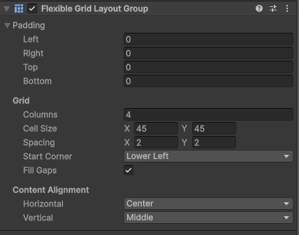
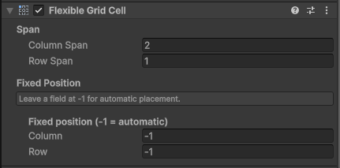

  

# Flexible Grid Layout

Based on Unity's built-in layout system, made for better grid / column editing and
managing, with custom cell sizes and adaptability to those cells.

A smarter grid than the stock `GridLayoutGroup`. Elements can span multiple columns
and rows, and the rest flow around the big ones automatically — just like CSS grid
auto-placement. The base cell is uniform, but any child can be, for example, 2×1 or 1×2.

## Install

**From disk**
1. `Window ▸ Package Manager`
2. `+` ▸ **Add package from disk…**
3. Select this folder's `package.json`.

**From git**
1. `Window ▸ Package Manager`
2. `+` ▸ **Add package from git URL…**
3. Paste the repository URL, e.g. `https://github.com/ArmaLv/FlexibleGridLayout.git`

## Usage

1. On a UI container, **Add Component ▸ Layout ▸ Flexible Grid Layout Group**.
2. On any child that should be bigger or pinned, **Add Component ▸ Layout ▸ Flexible Grid Cell**.

Both components live under the **Layout** group in the Add Component menu and carry a
grid icon in the Inspector, so they sit right alongside Unity's own layout components.

### Flexible Grid Layout Group

  

| Property | What it does |
|---|---|
| **Padding** | Inner padding of the container. |
| **Columns** | Fixed number of columns. Rows grow with the content. |
| **Cell Size** | Size of one 1×1 cell. |
| **Spacing** | Gap between cells on each axis. |
| **Start Corner** | Corner the layout fills from. |
| **Fill Gaps** | On: slot smaller elements into free gaps (dense packing). Off: flow sequentially, leaving holes behind large elements. |
| **Content Alignment** | Horizontal/Vertical placement of the whole block inside the container. |

### Flexible Grid Cell

  

| Property | What it does |
|---|---|
| **Column Span** | How many columns the element occupies. |
| **Row Span** | How many rows the element occupies. |
| **Column / Row** | Fixed 0-based position. Leave at `-1` for automatic placement. |

## Requirements

- Unity 2021.3 or newer
- Unity UI (`com.unity.ugui`) — resolved automatically as a dependency

## API

Namespace `UnityUtilities.FlexibleGridLayout`. `FlexibleGridLayoutGroup` derives from
`UnityEngine.UI.LayoutGroup`, so it works with `LayoutRebuilder` and the rest of the
uGUI layout pipeline. Public properties (`columns`, `cellSize`, `spacing`, `fillGaps`,
`startCorner`, `horizontalAlign`, `verticalAlign`) trigger a rebuild when changed.
